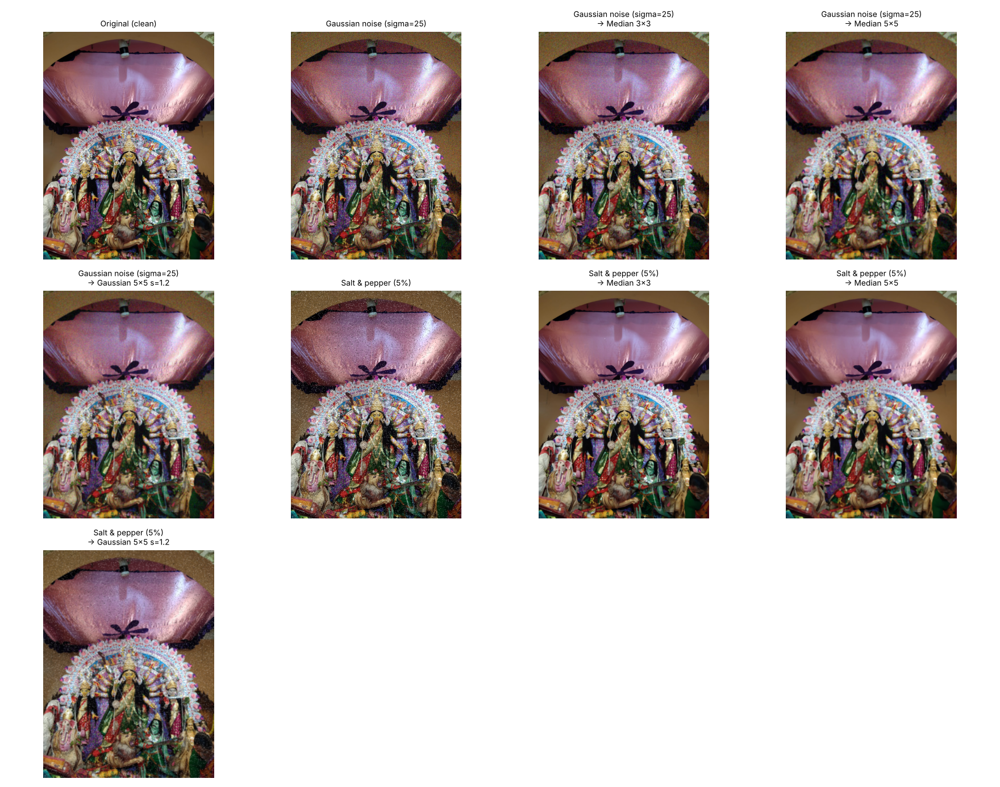
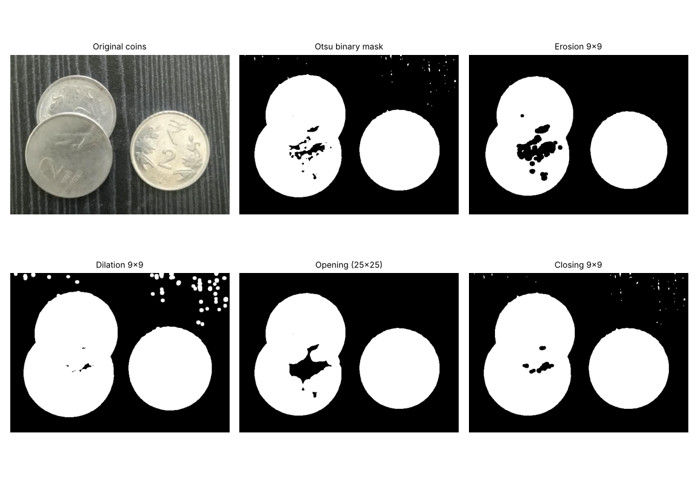
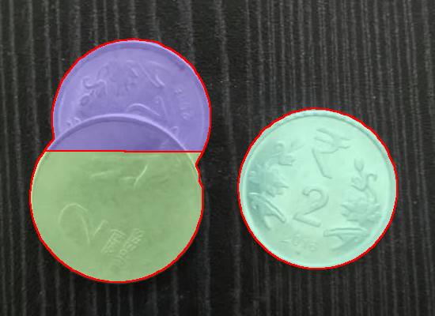
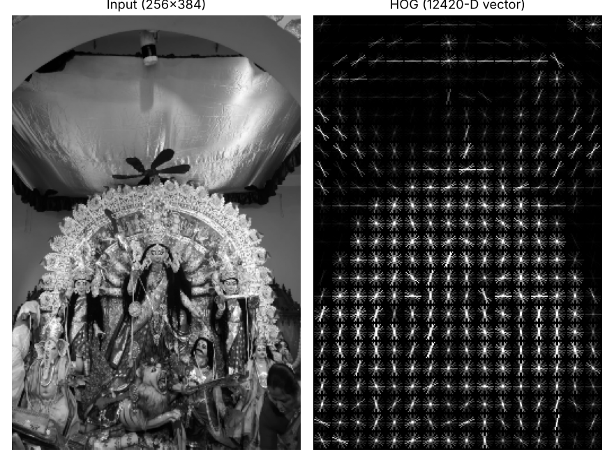
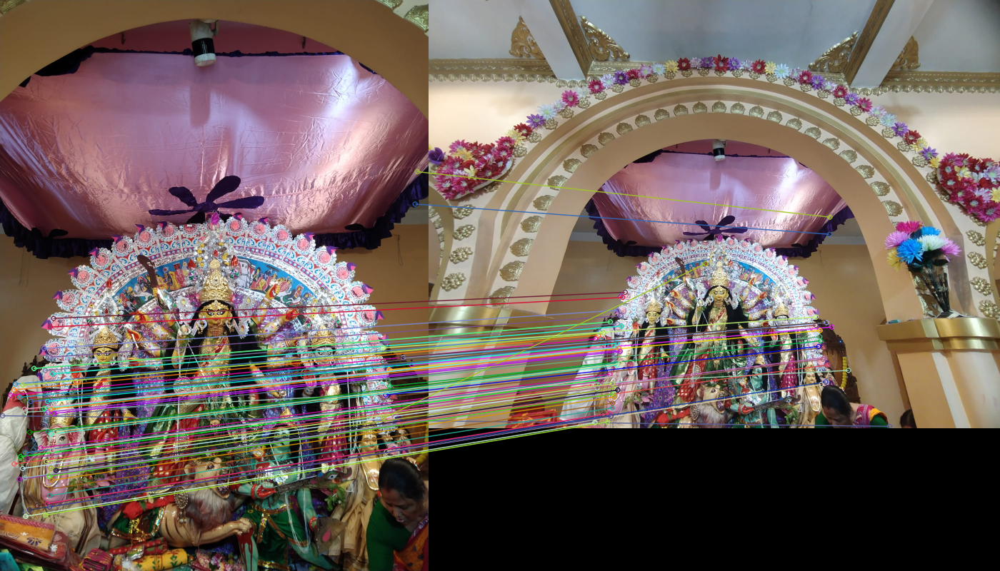
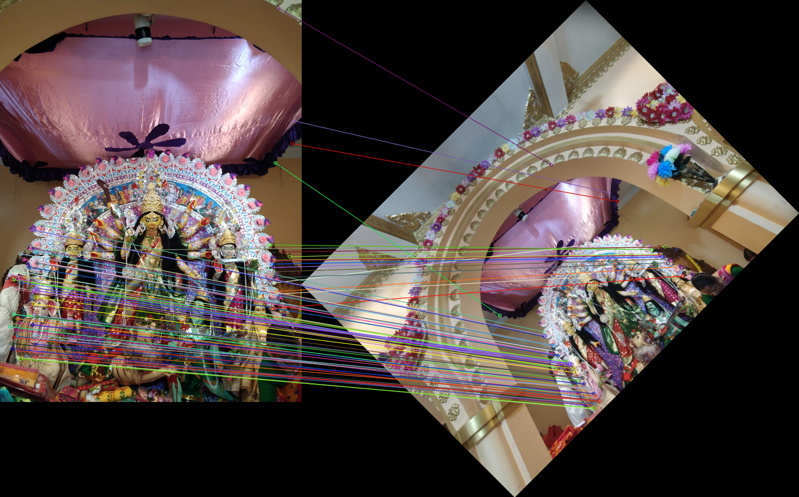
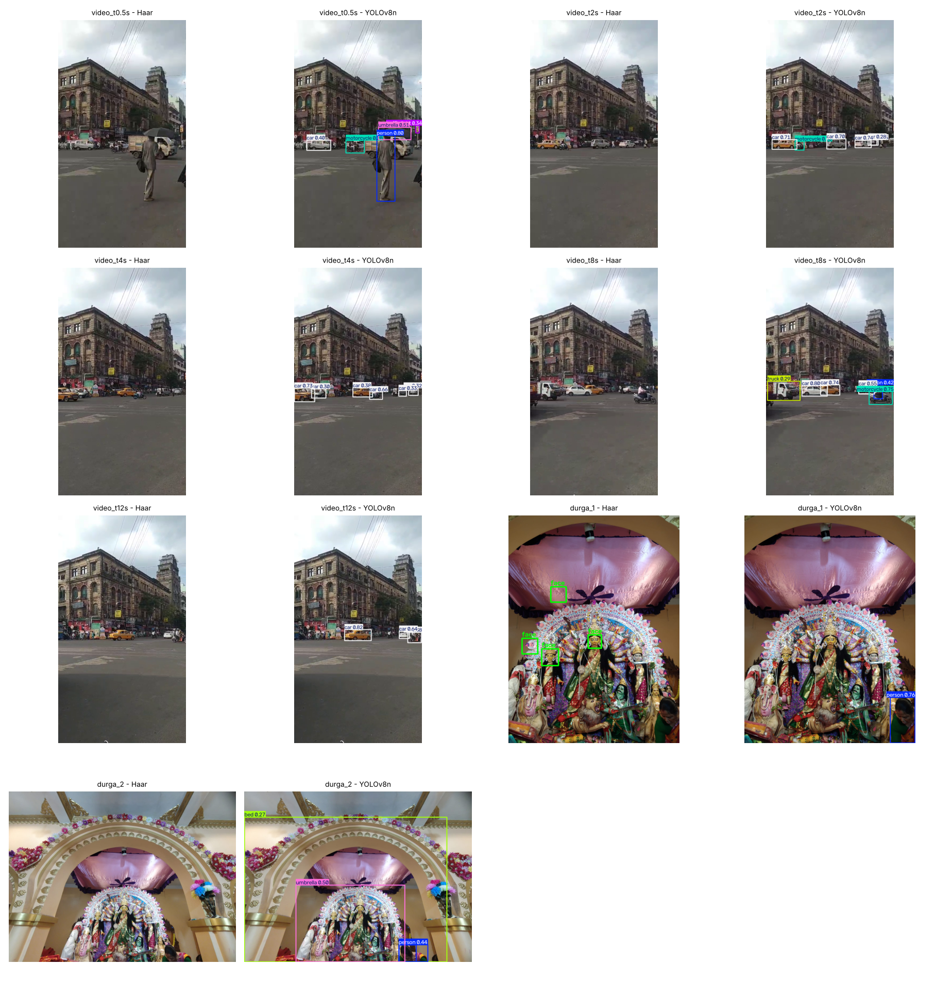
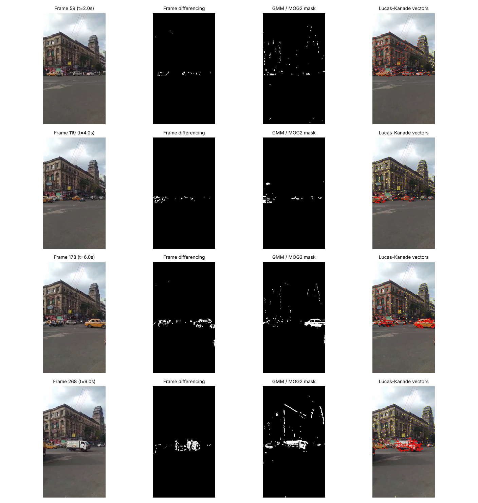

# 🔬 Vision Lab: Classical CV vs Deep Learning on Real-World Data

**CCA 3 – Practical Assignment (Units 3, 4, 5)** · Python · OpenCV · scikit-image · Ultralytics YOLO

All experiments use **my own photographs and my own street video** (Durga Puja pandal, ₹2 coins, a busy Kolkata crossing). The project compares classical techniques against each other, and Haar cascades against YOLO, with measured numbers.

## ✨ Highlights
| Task | Finding |
|---|---|
| Restoration | Gaussian filter best for Gaussian noise (**24.55 dB**); 3×3 median best for salt-and-pepper (**26.72 dB, SSIM 0.89**) |
| Segmentation | Watershed split overlapping coins: connected components found **2**, watershed found **3** |
| SIFT matching | **96 %** RANSAC inliers between two viewpoints; stable under 45°/90° rotation and 50 % resize |
| Haar vs YOLO | Haar found **0** objects in the street video; YOLOv8n found people, cars, motorcycles (conf. up to 0.82). Failure cases documented |
| Motion | GMM gives the fullest silhouettes, frame differencing gives fragments, Lucas–Kanade gives direction and speed |

## 🖼️ Results
**Restoration (noise → filters)**


**Morphology, edges, watershed**



**HOG and SIFT matching (original / rotated 45°)**




**Haar cascade vs YOLOv8**


**Frame differencing vs GMM vs Lucas–Kanade**


## 📁 Structure
```
data/        input photos, video (video on Drive), haarcascades/
src/         task1..task4 scripts, common.py, run_all.py
outputs/     all generated images + CSV metric tables
results/     selected result images shown above
docs/        build_report.py -> Technical_Report.docx
```
## 📥 Dataset
Photos are in `data/`. The raw video is large: download from **<GOOGLE DRIVE LINK>** and save as `data/video.mp4`. Haar XML files come from https://github.com/opencv/opencv/tree/4.x/data/haarcascades (`haarcascade_frontalface_default.xml`, `haarcascade_fullbody.xml`) into `data/haarcascades/`. YOLO weights download automatically.

## ▶️ Run
```
python -m venv venv && source venv/bin/activate   # Windows: venv\Scripts\activate
pip install -r requirements.txt
python src/run_all.py
python docs/build_report.py
```
## 📄 Report and video
- Technical report: `docs/Technical_Report.docx`
- Explanation video: **<DRIVE LINK>**

## ⚠️ Known limitations
Hand-held video causes false motion at edges; Haar and YOLO use pretrained default weights with no fine-tuning.
